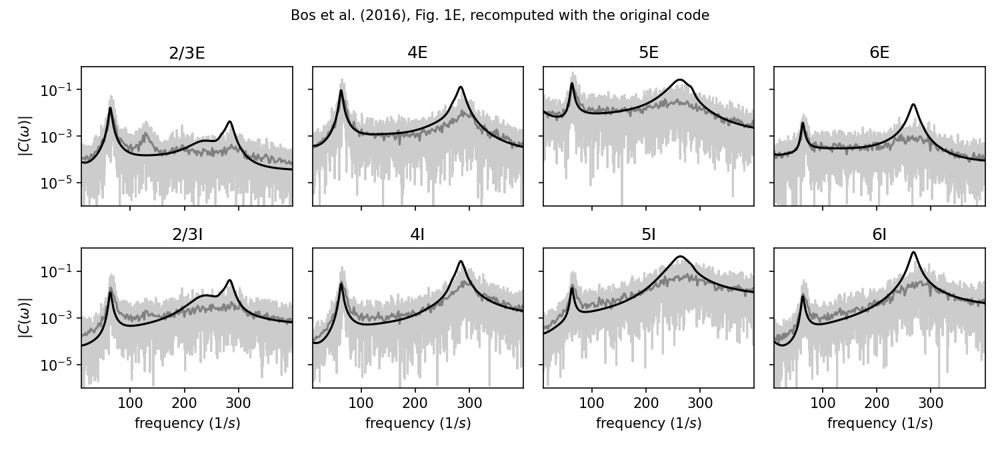

# Population-rate power spectra of the cortical microcircuit (Bos et al., 2016, Fig. 1E)

This folder contains ground-truth data for validating the power spectral
density (PSD) estimators of `elephant.spectral` against the simulated
population-rate spectra shown in Fig. 1E of

> Bos H, Diesmann M, Helias M (2016) Identifying Anatomical Origins of
> Coexisting Oscillations in the Cortical Microcircuit.
> PLoS Comput Biol 12(10): e1005132.
> [doi:10.1371/journal.pcbi.1005132](https://doi.org/10.1371/journal.pcbi.1005132)

The spectra were computed with the authors' original analysis code (not with
Elephant). They are used in the Elephant unit test
`elephant/test/test_spectral.py::BosEtAl2016PopulationRatePSDTestCase`.

*Light gray: spectrum of a single 9.7 s window; dark gray: average over 20
windows of 485 ms; black: mean-field theory `psd_ana`. All curves are two-sided PSDs of the
population rate in 1/s.*

## Origin of the data

The microcircuit model of Potjans and Diesmann (2014) (77 169 leaky
integrate-and-fire neurons in 8 populations: L2/3, L4, L5, L6, each
excitatory (E) and inhibitory (I)) was simulated for 10 s with NEST at a
resolution of 0.01 ms. The spike data and the original analysis code are part
of the code and data package of Bos et al. (2016). The package will be made
available on Zenodo (DOI to be added in
`code/generate_bos2016_fig1e_data.py`, variable `BOS_CODE_ZENODO_DOI`).

## Computation (original code)

For each population with N neurons, the original code (`read_sim.py`,
`microcircuit.get_spec_sim`)

1. selects all spikes with 300 ms < t < 10 000 ms (the first 300 ms are
   discarded as initial transient);
2. bins them with a bin width of Δt = 1 ms and divides the counts by N,
   giving x[n] (spikes per neuron per bin);
3. computes the spectrum with a rectangular window and no mean subtraction,

       P(f_k) = |Σ_n x[n] exp(-2πi k n / M)|² / (M Δt),   Δt in seconds,

   for the positive frequencies 0.1 Hz ≤ f_k < 500 Hz, where M is the number
   of bins;
4. does this once for the whole interval (1 window, M = 9700) and averages
   it over 20 consecutive, non-overlapping windows of 485 ms (M = 485).

Note: in step 1 the original code excludes the last neuron of each
population (`gid < gid_min + N - 1`), but it normalises by the full N.
Also, the windows are selected with strict inequalities, so spikes that
fall exactly on a window boundary are dropped from both adjacent windows.
For this reason, the input of the 1-window and the 20-window spectrum differ
in 32 of 77 600 bins, and both inputs are provided.

**Relation to standard definitions.** With the population rate
r[n] = x[n] / Δt (in 1/s), P is the *two-sided* periodogram estimate of the
PSD of r (unit 1/s). A one-sided PSD estimate (as returned by Elephant)
must therefore be divided by 2 before comparison.

## Content

`code/`
* `generate_bos2016_fig1e_data.py`: generates the files in `data/` and the
  figure. It imports the original module `read_sim.py` and uses its
  functions `create_spec` (binning, normalisation and spectrum), `cut_arrays`,
  `instantaneous_spike_count` and `get_gids`. Only the spike file reader
  (`read_sim.read_all_neurons`), the loop over windows
  (`microcircuit.get_spec_sim`) and the plotting of panel E
  (`microcircuit.plot_fig`) are re-implemented, because they are Python 2
  code. The script checks that the computed spectra agree with the spectra
  stored by the authors in `results.h5` (maximum relative deviation
  1.4·10⁻¹¹ for 1 window and 5.9·10⁻¹⁴ for 20 windows).
* `requirements.txt`: package versions used.

Usage:

    python generate_bos2016_fig1e_data.py --bos-code /path/to/original/package
    python generate_bos2016_fig1e_data.py   # download from Zenodo (once the DOI is set)

`data/`
* `bos2016_fig1e_input.npz`: input of the spectrum calculation

  | key | shape | description |
  |---|---|---|
  | `populations` | (8,) | population names `2/3E, 2/3I, 4E, 4I, 5E, 5I, 6E, 6I` |
  | `population_sizes` | (8,) | N per population |
  | `bin_size_ms` | () | Δt = 1 ms |
  | `t_start_ms`, `t_stop_ms` | () | 300 ms, 10 000 ms |
  | `x_full` | (8, 9700) | x[n] for the 1-window spectrum (spikes per neuron per bin) |
  | `x_windows` | (8, 20, 485) | x[n] for each of the 20 windows |
  | `window_starts_ms`, `window_length_ms` | (20,), () | window start times, 485 ms |

* `bos2016_fig1e_output.npz`: intended output (original code)

  | key | shape | description |
  |---|---|---|
  | `populations` | (8,) | population names |
  | `freq_1w`, `power_1w` | (4849,), (8, 4849) | frequencies (Hz) and spectrum P (1/s), 1 window |
  | `freq_20w`, `power_20w` | (242,), (8, 242) | frequencies (Hz) and spectrum P (1/s), average of 20 windows |
  | `freq_ana`, `psd_ana` | (3141,), (8, 3141) | frequencies (Hz) and theoretical spectrum C_ii (1/s), see below |
  | `power_ana_stored` | (8, 3141) | `power_ana` as stored in `results.h5`, equal to `psd_ana**2` |

`fig1E_reproduction.png`: Fig. 1E produced by the script.

## Theoretical spectrum

The mean-field (linear response) theory of Bos et al. (2016) gives the
spectrum matrix C(ω) = Q(ω) D Q(ω)^†, with Q = (1 - M̃(ω))^-1 (M̃: effective
connectivity) and D = diag(r_i / N_i) (r_i: theoretical firing rate in 1/s).
The original code (`meanfield/analytics.py`, function `spec`) stores the
*square* |C_ii(ω)|² as `power_ana` in `results.h5`, and the original figure
plots `sqrt(power_ana)` = C_ii. `psd_ana` therefore contains C_ii, the
two-sided PSD of the population rate in 1/s, the same quantity and
normalisation as `power_1w` and `power_20w`. Consistently, for high
frequencies Q → 1 and C_ii → r_i / N_i, the two-sided PSD of the averaged
rate of N_i independent Poisson neurons: at 500 Hz,
`psd_ana / (r_i / N_i)` lies between 1.01 and 1.22 for the 8 populations.

The theory is a prediction for the model, not an estimate from the data. It
agrees with the simulated spectra at the low-gamma peak (about 64 Hz), but
overestimates the high-gamma peak (235 Hz to 303 Hz), where the network is
close to a synchronous state and linear response theory is less accurate
(Bos et al., 2016, Section "Population rate spectra in simulations of the
microcircuit"). It is therefore not used as a reference in the unit test.

## Authors

* Data and analysis code: Hannah Bos, Markus Diesmann, Moritz Helias.
* Generation script and documentation: Michael Denker (Elephant team).

## License

Code: BSD 3-Clause. Data and figure: CC BY 4.0. See [LICENSE.md](LICENSE.md).

## References

1. Bos H, Diesmann M, Helias M (2016) Identifying Anatomical Origins of
   Coexisting Oscillations in the Cortical Microcircuit. PLoS Comput Biol
   12(10): e1005132. doi:10.1371/journal.pcbi.1005132
2. Bos H, Diesmann M, Helias M (2016) Data from: Identifying anatomical
   origins of coexisting oscillations in the cortical microcircuit. Dryad.
   doi:10.5061/dryad.815qq
3. Potjans TC, Diesmann M (2014) The cell-type specific cortical
   microcircuit: relating structure and activity in a full-scale spiking
   network model. Cereb Cortex 24(3): 785–806. doi:10.1093/cercor/bhs358
